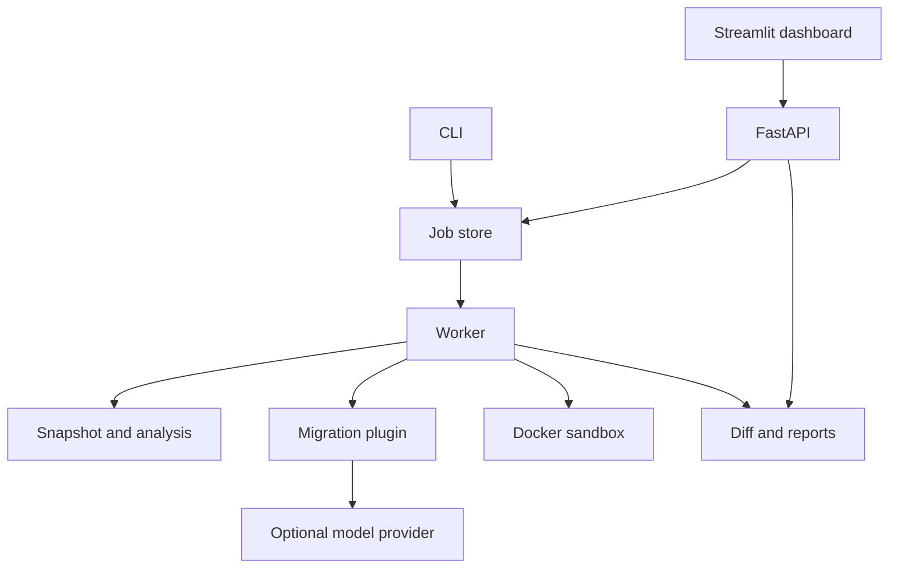
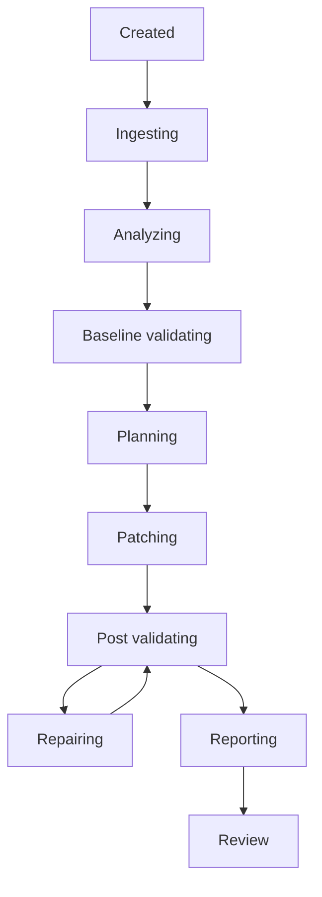

# Architecture

The API validates and queues jobs. The worker claims jobs using a conditional database update and renews a lease while they run. Analysis, planning, and patching are separate stages. PostgreSQL is the Compose database. SQLite supports local CLI and test use. Jobs and typed record categories live in SQLAlchemy tables. Full JSON analysis and reports and unified diffs are separate, atomically written workspace artifacts. Reads are limited to known artifact names.

Git intake resolves a ref to a commit, enumerates its tree, and reads its blobs without a checkout. ZIP input is extracted into a new directory with path, type, size, and count checks. The snapshot is fingerprinted and remains the baseline. Patching operates on a distinct copy with exact before-content verification and file-scope checks.

Scan stops after analysis, plan stops after planning, and dry-run generates an unvalidated diff. Cancellation, unsafe conditions, dependency failures and process failures produce explicit terminal states. If a worker lease expires, the next worker marks the job failed rather than replaying it. The job timeline is written independently of the final report.

The sandbox receives a tar stream of the target snapshot through stdin. It installs dependencies from a prepared wheelhouse and runs the selected checks in an offline container. It returns structured command results with pytest JUnit evidence. The comparison keys include normalized test case identifiers, failure signatures, image ID and Python version. The GitHub integration acts only on a separate approval request for a fully validated GitHub job. It verifies the base commit, builds a tree from validated content, and creates a job-specific branch with an idempotent PR lookup.
